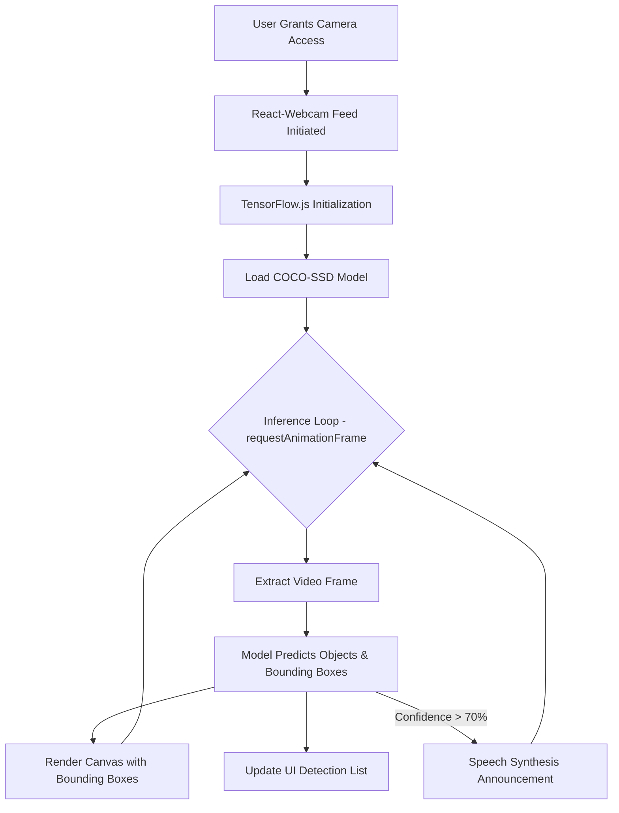

# Real-Time Object Detection 🎯

  

## 1. Project Overview
This project is a high-performance **Real-Time Object Detection** application that runs directly in the browser. It leverages a webcam feed to instantaneously detect and classify objects in view, drawing bounding boxes and confidence scores. It further features an accessibility-driven capability to announce detected objects out loud using the browser's native Speech Synthesis API. 

## 2. Project Description
Built on top of **React** (with TypeScript) and **Vite**, the application offers a lightning-fast and robust development footprint. At its core, it uses the **TensorFlow.js COCO-SSD** model to provide edge-based, client-side inference, ensuring user privacy and low latency without requiring server-side processing for the heavy lifting. **Tailwind CSS** forms the UI backbone, presenting a beautiful, modern, and dark-themed dashboard.

## 3. Key Features
- 🚀 **Real-Time Video Inference**: Captures live camera feeds via `react-webcam` and feeds them straight to TensorFlow.js.
- 🧠 **On-Device ML**: Uses the pre-trained `coco-ssd` model for completely local, privacy-respecting detection.
- 🗣️ **Auditory Feedback**: Automatically announces detected objects (with >70% confidence) using the Web Speech API; includes spam prevention (only announces once every 5 seconds).
- 🎛️ **Granular Controls**: Easily toggle the camera feed and mute/unmute speech synthesis.
- 🎨 **Responsive UI**: A polished dark-mode interface built purely with Tailwind CSS and sleek Lucide icons.

## 4. Project Workflow Diagram



## 5. Technical Specifications
- **Framework**: React 18 (TypeScript)
- **Bundler**: Vite 5
- **Styling**: Tailwind CSS
- **Machine Learning**: TensorFlow.js (`@tensorflow/tfjs`), COCO-SSD Model (`@tensorflow-models/coco-ssd`)
- **Key Modules**: 
  - `react-webcam` for video handling
  - `lucide-react` for iconography
- **Environment**: Node.js, Web Browser (Modern specs with WebGL/WebGPU support recommended for TF.js)

---

### Setup Instructions

1. **Clone the repository:**
   ```bash
   git clone <repository_url>
   cd Real-Time-Object-Detection
   ```

2. **Install dependencies:**
   Make sure you have Node.js installed, then run:
   ```bash
   npm install
   ```

3. **Run the development server:**
   ```bash
   npm run dev
   ```

4. **Build for production:**
   ```bash
   npm run build
   ```
